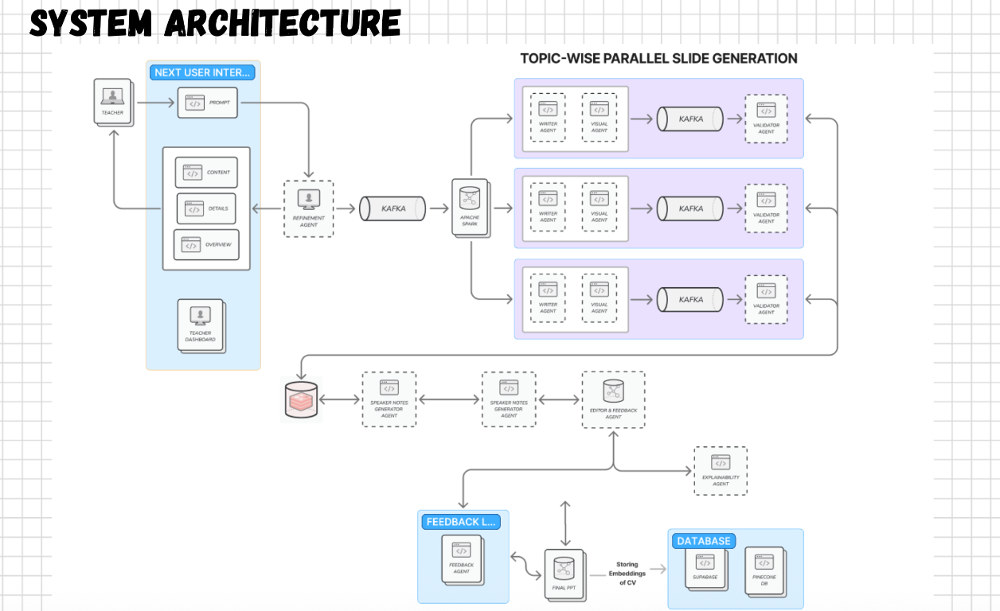
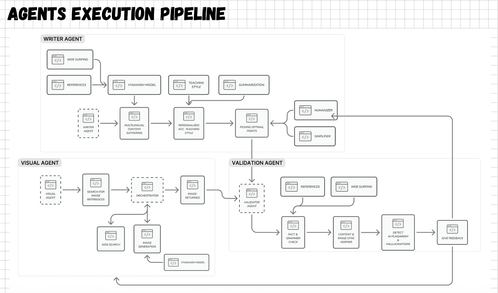

# Saathi: A Study Buddy That Works Online and Offline, In Your Language

> Upload your books, slides, and lectures. Ask doubts in your own language. Get simple, personal answers with proof. Use it **with or without the internet**.

Built for students who need a helpful tutor, even when the internet or powerful computers are not available.

---

## Why this exists

Most AI tutors need fast internet, a paid plan, and good English. Many students have none of these. Saathi is a tutor that:

- works **online for richer resources** and **offline on your own computer**
- speaks **18 Indian languages**
- answers from your material first and shows the source
- can find useful learning videos and research online
- **learns what you are weak at** and helps you improve

---

## Features

| Feature | What it means |
|---|---|
| **Upload anything** | PDFs, slides, lecture videos. No manual setup. |
| **Source links** | Every answer links to the exact page, slide, or video time. |
| **Honest refusals** | If your material doesn't cover it, Saathi says so. |
| **Online learning help** | Finds relevant research and educational YouTube videos in the learner's language. |
| **Grounded answers** | Uses uploaded material as the main source and shows pages, slides, or video times. |
| **Multilingual** | 18 Indian languages offline. Bhashini adds voice and translation when online. |
| **Adaptive quizzes** | Multiple modes and question types, each tagged by topic, source, and difficulty. |
| **Learner model** | Tracks mastery per topic and updates after every quiz and chat. |
| **Runs on a CPU** | QLoRA + GGUF + llama.cpp. No GPU needed. |

---

## Multi-agentic architecture

Saathi is not one AI prompt. It is a team of small agents. Each agent has one clear job, and they pass their work to the next agent.



**How to read this diagram:**

- The student or teacher starts the request in the app.
- A **Refinement Agent** turns it into clear topics.
- For each topic, **Writer** and **Visual** agents work in parallel.
- A **Validator Agent** checks the result before it is shown.
- **Speaker Notes**, **Editor**, **Feedback**, and **Explainability** agents improve the final lesson.
- The database stores the app data and feedback so the tutor can improve over time.

### Agent execution pipeline



The important part is simple:

1. The **Writer Agent** collects web information and references, then adapts it to the learner's teaching style.
2. The **Visual Agent** finds or creates useful visuals.
3. The **Validation Agent** checks facts, content, images, bias, and hallucinations.
4. The learner receives a clearer lesson, with feedback used for the next lesson.

This setup lets us do more than generate text. It helps us research, personalize, check, explain, and improve.

### Simple software view

```
 STUDENT (type or speak)
        |
        v
 +-----------------------------+
 |      APP (web / local)      |
 +-----------------------------+
        |
        v
 +-----------------------------+      +--------------------------+
 |   AGENTS  (LangGraph)       |<---->|   KNOWLEDGE BASE         |
 |  Researcher -> finds context |      |  books / slides / videos |
 |  Video Finder -> finds help  |      |  chunks + topic tags     |
 |  Teacher -> explains simply  |      |  page / slide / time     |
 |  Checker -> checks grounding |      +--------------------------+
 |  Quiz Maker -> tests learning|
 |  Tutor -> tracks progress    |
 +-----------------------------+
        |
        v
 +-----------------------------+      +--------------------------+
 |   LOCAL MODEL               |      |  STUDENT PROFILE         |
 |  QLoRA + GGUF + llama.cpp   |      |  mastery, history,       |
 |  CPU only, offline          |      |  mistakes                |
 +-----------------------------+      +--------------------------+
        |
        v
 ANSWER + SOURCE  /  QUIZ  /  PROGRESS REPORT
```

### Online and offline modes

- **Offline:** the local model answers from the student's own files. This works without internet or a GPU.
- **Online:** agents work together to research a topic, find a useful YouTube lesson, explain it in simple words, and stream the answer as it is created.
- **Ground truth:** uploaded books, slides, and lectures are the trusted base. Online sources add context, but the Checker can flag weak support or say when the answer is not known.
- **Personalized:** the Tutor uses the learner's level, language, teaching style, past mistakes, and weak topics to change the explanation and quiz.
- **Language support:** Bhashini adds speech and translation when online. The local model keeps the core experience available offline.

### What makes the online tutor different

Instead of asking one AI to do everything, Saathi gives each job to a small agent:

1. **Researcher** finds supporting information.
2. **Video Finder** searches for a useful, embeddable YouTube lesson in the right language.
3. **Teacher** turns the material into a simple explanation.
4. **Checker** compares the answer with the available sources.
5. **Quiz Maker** creates questions from the lesson.
6. **Tutor** uses the learner's history to choose what to teach next.

These jobs run in parallel where possible. This makes the tutor faster, gives students more than one way to learn, and keeps the answer connected to evidence.

---

## How it works

1. **Add material:** books, slides, and videos are split into small chunks. Each chunk keeps its page, slide, or timestamp.
2. **Ask a doubt:** the system finds the best supporting material. Online mode can also research and find a YouTube lesson.
3. **Explain and check:** the Teacher gives a simple answer. The Checker checks it against the sources or says it cannot confirm it.
4. **Practice:** the Quiz Maker creates questions from the lesson and links feedback to the source.
5. **Improve:** the Tutor tracks mistakes and weak topics, then changes the next explanation and quiz.

---

## Results

| Test | Result |
|---|---|
| 30-question test set | Faithfulness **[X]**, Answer relevancy **[X]**, Context precision **[X]**, Context recall **[X]** |
| 10 simulated students, multiple sessions | Mastery gain **[X]%**, repeated questions **[X]%** |
| CPU speed (**[hardware]**) | About **[X] s** per answer |

---

## Tech stack

- **Agents:** LangGraph
- **Model:** QLoRA fine-tune, GGUF, llama.cpp
- **Languages:** 18 Indian languages offline, Bhashini online
- **Retrieval:** **[vector store]**
- **App:** **[frontend / backend]**
- **Evaluation:** **[RAGAS / DeepEval / other]**

---

## Getting started

```bash
# 1. Clone the project
git clone https://github.com/VirusHacks/multimodal-offline-personalized-teacher.git
cd multimodal-offline-personalized-teacher

# 2. Install JavaScript packages
npm install

# 3. Create a local environment file named .env.local
touch .env.local

# 4. Create/update the database
npm run db:push

# 5. Start the app
npm run dev
```

Open **http://localhost:3000** in your browser.

### Environment variables

Add these values to `.env.local`:

```env
DATABASE_URL="file:./dev.db"
OPENAI_API_KEY="your-openai-key"
TOGETHER_AI_API_KEY="your-together-key"
GOOGLE_CLIENT_ID="your-google-client-id"
GOOGLE_CLIENT_SECRET="your-google-client-secret"
NEXTAUTH_URL="http://localhost:3000"
NEXTAUTH_SECRET="a-long-random-secret"
```

For the full online experience, also add:

```env
TAVILY_API_KEY="your-tavily-key"
YOUTUBE_API_KEY="your-youtube-key"
BHASHINI_USER_ID="your-bhashini-user-id"
BHASHINI_API_KEY="your-bhashini-key"
```

The online keys enable web research, YouTube learning videos, and Indian-language voice or translation. The local model and uploaded material support the offline experience.

> Never commit `.env.local` or share API keys.

**Minimum computer:** **8 GB RAM, a modern CPU, and no GPU required for the offline mode.**

---

## Roadmap

- Pilot with real students in rural schools
- Study plans from weak topics and forgetting curves
- Flashcards and audio summaries
- Teacher view for class-wide weak topics
- More subjects and more local languages
- Lighter models for very old computers

---

## License

[MIT or your license]